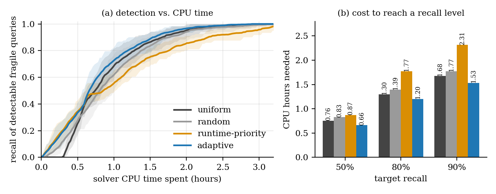
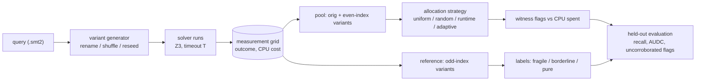

# fragile-proofs

**Budget-aware detection of fragile SMT proofs.** Given a set of SMT queries and a fixed amount of solver CPU time, in which order should
semantically equivalent variants of the queries be tested so that as many *fragile* queries as possible are exposed as early as possible?

A query is **fragile** (unstable) when a harmless change, such as renaming its symbols, reordering its assertions or changing the solver's
random seed, flips the outcome from success to failure. This repository contains an open, tested pipeline for studying that question,
the measurements from a pilot study on the [Mariposa](https://github.com/secure-foundations/mariposa) benchmark, and the accompanying technical report.

> **Status:** research prototype (v0.1.0). The pilot study is small and has clear limits (see [Limitations](#limitations)); the pipeline is the more durable output.

## Headline results

Pilot study: 268 queries from the Mariposa benchmark (five project groups), Z3 4.12.2, 10 s timeout, 8,744 distinct solver measurements, 9.76 CPU hours.
Strategies are compared by replay against ground-truth labels computed from *independent reference variants* that no strategy sees, with
hyper-parameters tuned on *held-out projects*. Exhaustively testing every pool variant of every query would cost 4.72 CPU hours.

| strategy | AUDC (95% over 20 seeds) | CPU hours to 50% recall | to 80% | to 90% | AUDC difference to uniform |
|---|---|---|---|---|---|
| uniform (breadth-first) | 0.810 [0.785, 0.840] | 0.76 | 1.30 | 1.68 | n/a |
| random | 0.803 [0.768, 0.838] | 0.83 | 1.39 | 1.77 | -0.007 [-0.025, +0.006], better in 5/20 seeds |
| runtime-priority | 0.779 [0.756, 0.812] | 0.87 | 1.77 | 2.31 | -0.032 [-0.054, -0.011], better in 0/20 seeds |
| **adaptive** (cost-aware Bayesian) | **0.835** [0.813, 0.863] | **0.66** | **1.20** | **1.53** | +0.025 [+0.014, +0.033], better in 20/20 seeds |
| adaptive, tuned on held-out projects | 0.833 [0.813, 0.861] | 0.66 | 1.20 | 1.58 | +0.023 [+0.013, +0.031], better in 20/20 seeds |

AUDC is the area under the (normalised) detection curve; the difference between two AUDCs is the CPU time saved averaged over recall levels, as a fraction of the exhaustive cost.



**What these results do and do not say.**

* The adaptive strategy finds fragile queries somewhat earlier than uniform testing (roughly 7-12% less CPU time to reach a given recall). The effect is small but consistent across replay seeds.
* A natural "test the slow queries first" heuristic is **worse** than uniform testing.
* Project-level pooling, a slowness boost, exploration and held-out tuning each make no measurable difference; the gain comes from the core model (probability that the next test reveals a witness, per expected CPU second).
* Part of the early-budget gap over uniform testing is an artefact of its breadth-first schedule; the mid-budget gap is the more informative one.
* The adaptive strategy flags more queries that the independent reference does not corroborate (label precision 77% vs 83% for uniform at 25% of the budget).
* Most of the saving versus exhaustive testing comes from the **shared stopping rule** (stop testing a query once it has a witness), which all strategies use.
* Validity checks: no curated-stable-core query is labelled fragile (0/81) while 45% of curated-unstable queries are; 4 of 268 unchanged queries flip outcome on identical input (1.5%); all 30 re-run witness pairs reproduced.
* Only five project groups were available, so no project-level confidence interval is given. The intervals above reflect variant order and strategy randomness only.

Full tables, ablations, uncorroborated-flag breakdown and discussion: [`results/summary.md`](results/summary.md) and the report in [`paper/`](paper/main.tex).

## Quick start

```bash
python3 -m venv .venv && source .venv/bin/activate
pip install -r requirements.txt            # numpy, matplotlib, z3-solver 4.12.2.0
python -m fragile check                    # verifies the solver and the exact flags this tool uses
python -m unittest discover -s tests       # 40 tests (a real-Z3 test runs if z3 is found)
python -m fragile demo                     # end-to-end run on SYNTHETIC data with a mock solver (a few seconds)
```

`pip install -e .` additionally installs a `fragile` command. Requires Python 3.9+; developed and tested on Linux (Ubuntu 22.04 with Python 3.10, and Ubuntu 24.04 with Python 3.12).
The `demo` command uses a **synthetic mock solver**: it exercises the code and its numbers are labelled as synthetic everywhere; they say nothing about real solvers.

New to the terminal? [`docs/BEGINNER_GUIDE.md`](docs/BEGINNER_GUIDE.md) has copy-paste steps for the whole study.

## Reproducing the study

**Replay only (minutes, no solver needed).** The raw measurement log is in [`results/raw/`](results/raw). The evaluation is deterministic (fixed seeds), so this reproduces
[`results/summary.md`](results/summary.md) (re-running it from the shipped log in an independent environment with NumPy 2.4.4 gave bit-identical statistics; other NumPy versions could in principle differ in the last digits):

```bash
python -m fragile evaluate results/raw --ablations
```

**Full measurement (about 2.5 hours on an AMD Ryzen 7 6800H, four workers; the published measurements were taken under Ubuntu 22.04).**

```bash
git clone --depth 1 --filter=blob:none --sparse https://github.com/secure-foundations/mariposa-data.git ~/mariposa-data
git -C ~/mariposa-data sparse-checkout set benchmarks                      # about 300 MB
python -m fragile prepare-mariposa ~/mariposa-data/benchmarks --out data_mariposa
python -m fragile collect --queries ~/mariposa-data/benchmarks --manifest data_mariposa/manifest.csv \
    --out runs/main --per-project 60 --workers 4 --timeout 10 --mem-mb 3000
python -m fragile status runs/main                                        # health check: errors, load, noise controls
python -m fragile evaluate runs/main --ablations                          # strategies, tuning, figures, summary.md
python -m fragile confirm runs/main --repeats 5 --max 30                  # re-run witnesses, write evidence bundles
scripts/export_results.sh runs/main                                       # copy shareable outputs into results/
```

`collect` is resumable (Ctrl+C is safe; re-run the same command). It refuses to mix measurements taken with different solver, timeout, seed or limits in one `--out` folder.
Record the solver version (`z3 --version`) and the commit of the data repository. The query files themselves are not redistributed here; they come from
[`mariposa-data`](https://github.com/secure-foundations/mariposa-data), whose licence and citation requirements apply.

## How it works



* **Variants** (`fragile/smt2.py`, `fragile/variants.py`). A lossless SMT-LIB splitter plus three meaning-preserving rewrites: consistent renaming of the symbols the script declares (token-level, never inside strings or comments), permutation of runs of consecutive `assert` commands (never across declarations, `push`/`pop` or `check-sat`), and solver reseeding. Every variant is a deterministic function of (seed, query id, variant id), so it can be regenerated for evidence.
* **Measurement** (`fragile/solver.py`, `fragile/collect.py`). Runs `z3 -smt2 -T:<timeout>` as a child process and records outcome, wall time and child CPU time. Timeouts are charged the full timeout so budgets do not depend on machine load. Solver errors are **not** counted as failures. The unchanged original is re-run to quantify noise.
* **Witnesses and labels** (`fragile/grid.py`). A *witness* is a pair of equivalent variants with different success/failure status; a query is *flagged* once it has one. Ground-truth labels come from the independent *reference* variants: fragile = success rate in [0.1, 0.9], pure = 0 or 1, borderline otherwise.
* **Strategies** (`fragile/strategies.py`). Uniform, random, runtime-priority and adaptive. All share the stopping rules (never re-test a flagged or exhausted query) and see identical variant orders per seed, so they differ only in *which query gets the next test*. The adaptive strategy ranks queries by posterior probability that the next test creates a witness divided by expected cost, with project-level shrinkage, a slowness boost and an exploration reserve; it never sees labels.
* **Evaluation** (`fragile/simulate.py`, `fragile/evaluate.py`). Replay on the recorded grid for 20 seeds; 3-fold cross-validation over projects for tuning; detection curves, AUDC, CPU hours to fixed recall, uncorroborated flags, optional project bootstrap (needs at least 8 projects).
* **Live use** (`fragile/live.py`). `hunt` runs a strategy against a real solver under a CPU budget; `confirm` re-runs witness pairs and writes evidence bundles (both variants plus a `reproduce.sh`).

Details, formulas and the evaluation protocol are in Sections 2-3 of the [report](paper/main.tex).

## Command reference

| command | purpose |
|---|---|
| `check` | verify Python libraries, the Z3 binary and every flag the tool uses (timeout, memory, seeds); check variants agree on a tiny query |
| `demo` | end-to-end run on synthetic data with the mock solver |
| `scan DIR` | list projects and check that queries parse and have exactly one `check-sat` |
| `prepare-mariposa DIR` | infer project and curated group of each Mariposa benchmark query and write a manifest CSV |
| `collect` | measure the (query x variant) grid in parallel; resumable; `--dry-run` prints the plan and worst-case cost |
| `status RUN` | outcome counts, errors, machine load, noise controls, completeness |
| `evaluate RUN` | replay strategies, tune on held-out projects, write `results/summary.md`, `eval.json` and figures (`--ablations`, `--tau`, `--label-mode`, `--quick`) |
| `hunt` | run a strategy live against a real solver with a CPU budget |
| `confirm RUN` | re-run witness pairs and write evidence bundles |

Run `python -m fragile COMMAND --help` for all options.

## Data formats

* `observations.jsonl`: one JSON object per solver run: `query`, `variant` (e.g. `rename:3`; `orig:0` is the unchanged query), `repeat`, `outcome` (`unsat`, `sat`, `unknown`, `timeout`, `memout`, `error`), `wall_s`, `cpu_s`, `cost_s` (CPU time; the full timeout for timeouts), `load1`, `ts`.
* `queries.json`: per query `qid`, `project`, `group` (curated group, if known), `variants` (the planned variant ids).
* `meta.json`: solver id and version, timeout, memory limit, seed, families, host description, command line. Host names and absolute paths are removed in the published copy.

## Repository layout

```
fragile/            package (about 2,500 lines)
  smt2.py             lossless SMT-LIB splitting, renaming, assertion shuffling
  variants.py         deterministic variants; pool / reference split
  solver.py           Z3 runner (CPU-time accounting) and a SYNTHETIC mock solver
  collect.py          discovery, sampling, parallel measurement
  mariposa.py         manifest builder for the Mariposa benchmark layout
  grid.py             measurements -> replay arrays and labels
  strategies.py       uniform, random, runtime-priority, adaptive
  simulate.py         replay and detection curves
  evaluate.py         folds, tuning, paired seeds, project bootstrap
  report.py           status, noise controls, figures, summary.md
  live.py             hunt (live scheduler), confirm, evidence bundles
  check.py, demo.py, store.py, cli.py
tests/              40 unit and end-to-end tests
results/            summary, eval.json, figures, confirmations, anonymised metadata, raw log
paper/              technical report (LaTeX source and figures)
docs/               beginner guide
scripts/            export_results.sh
```

## Limitations

* **One benchmark subset.** 268 queries, five project groups (Komodo_D and Komodo_S are pooled because projects were inferred from file names), a benchmark that is enriched for unstable queries by construction, one solver version (Z3 4.12.2), one timeout (10 s, versus 60 s used to curate the benchmark), one machine.
* **Statistics.** Intervals reflect replay seeds, not sampling of queries or projects; no project-level interval is possible with five projects. The planned label-threshold and label-mode sensitivity analyses have not been run.
* **Definitions.** "Fragile" here means a witness pair plus a reference success rate in [0.1, 0.9]. This is not Mariposa's statistical stability test and, like all current metrics, depends on the timeout. The rewrites are an independent implementation of the three mutation families, not Mariposa's mutator.
* **Replay, not live.** Strategies were compared on recorded measurements. They choose which query to test, not which variant. Witnesses near the timeout can be noise; re-running the 30 cheapest witnesses is not a random sample.
* **One run hit the 3000 MB memory limit** (`memout`, counted as a failure). It was first misclassified as a solver error by an output-parsing bug (Z3 reports the condition on stderr), which dropped it from the analysis; the bug is fixed, covered by a regression test, and the run was re-measured (`collect --retry-errors`). The superseded record stays in the raw log. The correction moved no AUDC value by more than 0.002 and changed no conclusion.
* **Environment change.** After the main collection the laptop was upgraded from Ubuntu 22.04 to 24.04 (same Z3 4.12.2 package). The re-measured run, the evaluation and the witness re-runs were done on 24.04; the witness pairs, recorded on 22.04, reproduced.
* The adaptive model is a heuristic with unverified assumptions; ablations show three of its components are not needed for the observed gain. No ablation removes the cost term.
* Novelty relative to existing instability work has not been established beyond the limited literature search described in the report.

## Related work and data

* Mariposa: Zhou et al., *Mariposa: Measuring SMT Instability in Automated Program Verification*, FMCAD 2023. Tool: <https://github.com/secure-foundations/mariposa>; data: <https://github.com/secure-foundations/mariposa-data>.
* Cebeci, Bjorner, Candea, Pit-Claudel, *A Conjecture Regarding SMT Instability*, SMT 2025: <https://ceur-ws.org/Vol-4008/SMT_paper21.pdf>; and *A Deeper Look at Depth: Stable Generation Accounting for Quantifier Reasoning*, arXiv:2609.26345.
* Zhou et al., *Cazamariposas: Automated Instability Debugging in SMT-based Program Verification* (CMU technical report, 2025); Amrollahi et al., *Using normalization to improve SMT solver stability*, arXiv:2410.22419; Shah et al., *Instability Track for SMT-COMP*, SMT 2025: <https://ceur-ws.org/Vol-4008/SMT_paper19.pdf>.

Two of the confirmed witness queries (`lemma_2toX`, `set_bit_to_0_self_uint64`) are among the 11 queries root-caused by Cebeci et al.; this pipeline surfaces them but makes no claim about root cause in Z3 4.12.2. A fuller bibliography is in the report.

## Citing

Please cite the repository using [`CITATION.cff`](CITATION.cff) (GitHub's "Cite this repository" button), and the Mariposa paper if you use its benchmark.

## License

[MIT](LICENSE). The Mariposa queries are not part of this repository.

## Acknowledgments

Thanks to the authors of Mariposa for releasing their tool and benchmark.
